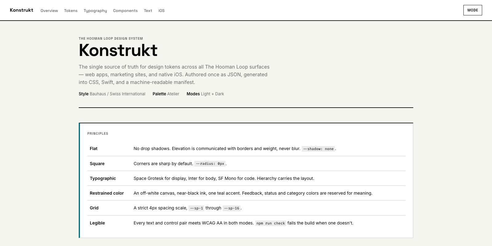
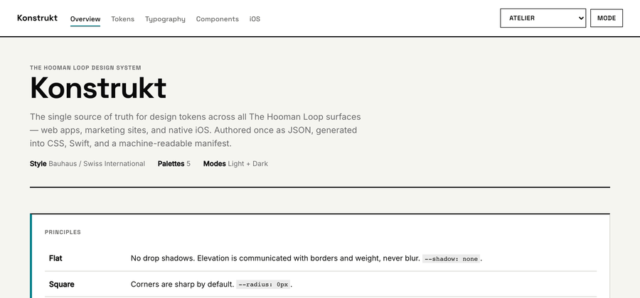
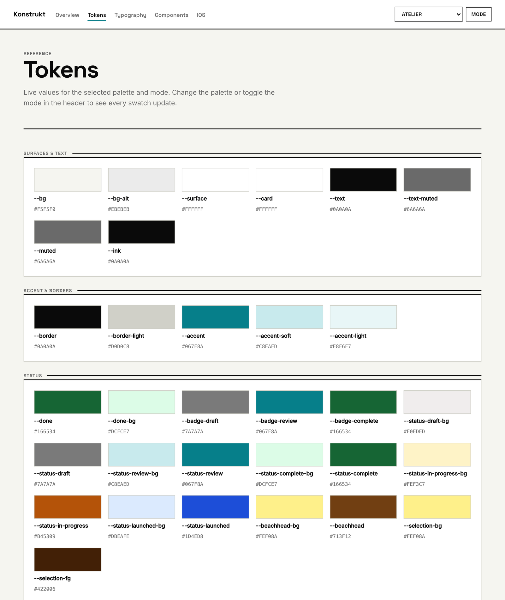
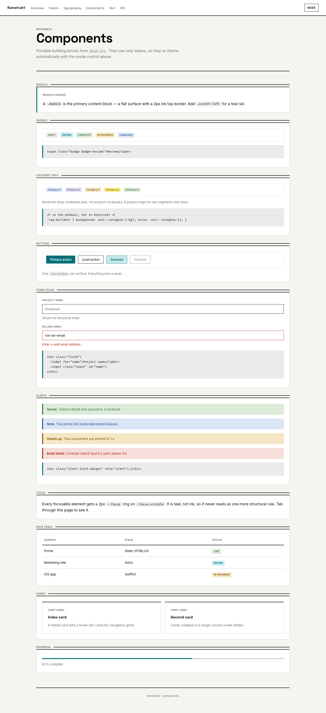
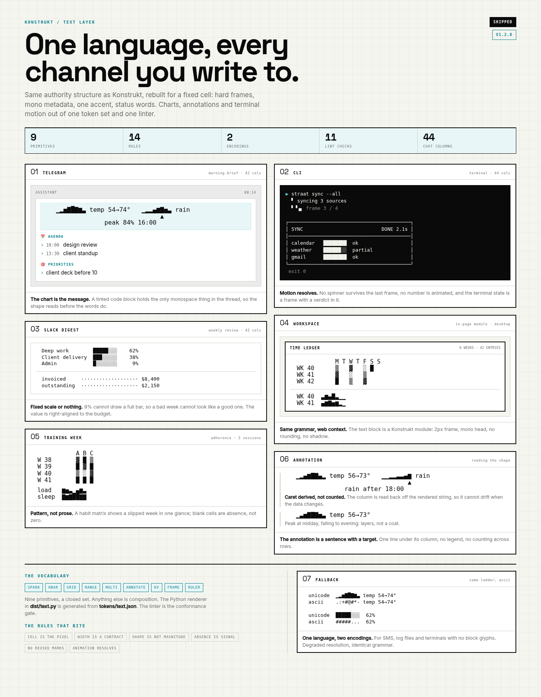
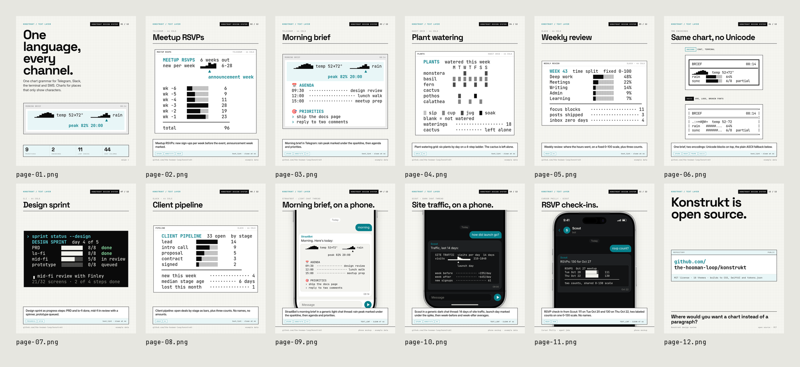

# Konstrukt

[](https://github.com/the-hooman-loop/konstrukt/actions/workflows/verify.yml)
[](LICENSE)

The Hooman Loop design system. JSON-first design tokens, generated into CSS,
Swift/SwiftUI, a JSON manifest, and a text/ASCII output layer, with a
self-contained documentation site.

Konstrukt is the single source of truth: edit tokens in `tokens/`, run the
build, and every surface — web apps, marketing sites, internal tools, native
iOS, and character-cell channels — follows.



Ten themes · 78 resolved tokens per theme · 4 output targets · 0px radius ·
0 shadows. Bauhaus / Swiss International: flat surfaces, square corners,
authority through typography rather than chrome.

## Ten themes, one token set



Every theme is the intersection of two orthogonal axes, set as attributes on
`<html>`: a **palette** (`atelier` · `courage` · `minimal` · `hl` · `blueprint`)
and a **mode** (`light` · `dark`). Five palettes × two modes, resolved at build
time into ten flat token sets. No runtime interpolation, no theme math in the
browser.

## Quick start

```bash
npm install
npm run build      # tokens/ -> dist/ (CSS, Swift, tokens.json, text) + docs/assets
npm run check      # parity gate vs the canonical snapshot
npm run check:text # text-layer linter + golden board
npm run docs       # serve the docs site on http://localhost:4340
```

## What it produces

| Output | Path | For |
|--------|------|-----|
| Themed CSS | `dist/css/konstrukt.css` | all web surfaces (palette × mode) |
| Components | `dist/css/base.css` | portable Konstrukt components |
| Theme runtime | `dist/css/theme.js` | `HLTheme` — sets mode/palette on `<html>` |
| Text embed | `dist/css/text.css` | `pre.kt` styling for character-cell blocks |
| Swift package | `dist/swift/Konstrukt/` | iOS / SwiftUI |
| Manifest | `dist/tokens.json` | tooling, design apps, AI agents (includes `text`) |
| Text spec | `dist/text.json` | glyph ladders, column budgets, reserved marks |
| Text renderer | `dist/text.py` | vendored into cron collectors, briefings, CLI tools |
| Docs site | `docs/` | reference + integration guides |

## Tokens

Every token is authored once, in W3C DTCG JSON, and its path becomes its CSS
custom property: `status.draft-bg` → `--status-draft-bg`. The reference page
reads the generated manifest, so what you see is what ships.



## Components

The portable component vocabulary: modules with 2px ink borders, status pills,
segmented filters, data tables, question lists. Square by default, no shadows,
teal reserved for the one primary action on a surface.



## Text layer

Charts, annotations and CLI motion for channels that render characters instead
of pixels. Nine primitives, two encodings, and a linter that fails a build when
a chart lies about a number.

The text layer is part of the versioned contract. Glyph ladders, column budgets
and reserved marks live in [`tokens/text.json`](tokens/text.json). `npm run build`
emits `dist/text.json` and a self-contained `dist/text.py` for vendoring. Read
the spec: [`docs/text.md`](docs/text.md). Run the renderer:
`python3 dist/text.py`.



### Chart designs

Twelve compositions that use the shipped primitives. Numbers on the slides are
example data; the phones are mockups, not device captures.



<details>
<summary>Individual slides</summary>

| # | Slide | File |
|---|-------|------|
| 1 | One language, every channel | [page-01.png](assets/readme/text-layer/page-01.png) |
| 2 | Meetup RSVPs | [page-02.png](assets/readme/text-layer/page-02.png) |
| 3 | Morning brief | [page-03.png](assets/readme/text-layer/page-03.png) |
| 4 | Plant watering | [page-04.png](assets/readme/text-layer/page-04.png) |
| 5 | Weekly review | [page-05.png](assets/readme/text-layer/page-05.png) |
| 6 | Same chart, two encodings | [page-06.png](assets/readme/text-layer/page-06.png) |
| 7 | Design sprint | [page-07.png](assets/readme/text-layer/page-07.png) |
| 8 | Client pipeline | [page-08.png](assets/readme/text-layer/page-08.png) |
| 9 | Morning brief, on a phone | [page-09.png](assets/readme/text-layer/page-09.png) |
| 10 | Site traffic, on a phone | [page-10.png](assets/readme/text-layer/page-10.png) |
| 11 | RSVP check-in | [page-11.png](assets/readme/text-layer/page-11.png) |
| 12 | Konstrukt is open source | [page-12.png](assets/readme/text-layer/page-12.png) |

</details>

## Documentation

- Design system reference and live token explorer: `npm run docs`, or the
  published copy at [thehoomanloop.com/konstrukt](https://thehoomanloop.com/konstrukt).
- Text layer reference: [`docs/text.html`](docs/text.html). Spec:
  [`docs/text.md`](docs/text.md). Review sheet:
  [`docs/text-review.html`](docs/text-review.html).
- The full contract — token model, build, parity gate, consumption, and
  adoption status — is in [`DESIGN.md`](DESIGN.md).
- iOS integration: `docs/ios.html`.
- Deploying the docs: [`scripts/README-deploy.md`](scripts/README-deploy.md).

## Editing tokens

Author tokens in `tokens/` as W3C DTCG JSON. A token's path becomes its CSS
custom property (`status.draft-bg` → `--status-draft-bg`). Never edit anything
in `dist/` — it is generated. After editing, run
`npm run build && npm run check && npm run check:text`.

## Proposals

`proposals/` holds work that is under review and promises nothing. It has no
version, no gate, and no compatibility guarantee. When a proposal is stable it
is promoted into `tokens/` and `src/` through the checklist in
[`CONTRIBUTING.md`](CONTRIBUTING.md), and only then does it ship.

## Contributing

Read [`CONTRIBUTING.md`](CONTRIBUTING.md) first. The short version: a new
output needs a gate, a new primitive needs a real consumer in the same pull
request, and a vendored copy carries a version stamp.

## License

MIT for the code and tokens. The Konstrukt name and marks are not covered by
the license. See [`LICENSE`](LICENSE).

---

Konstrukt is a project of The Hooman Loop.
